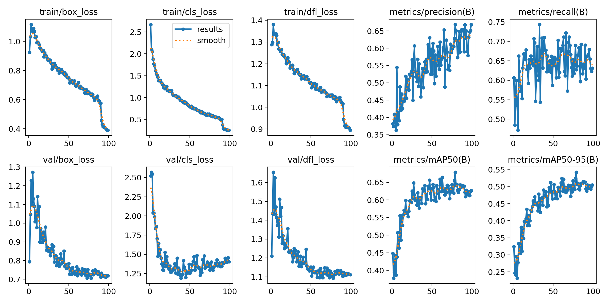
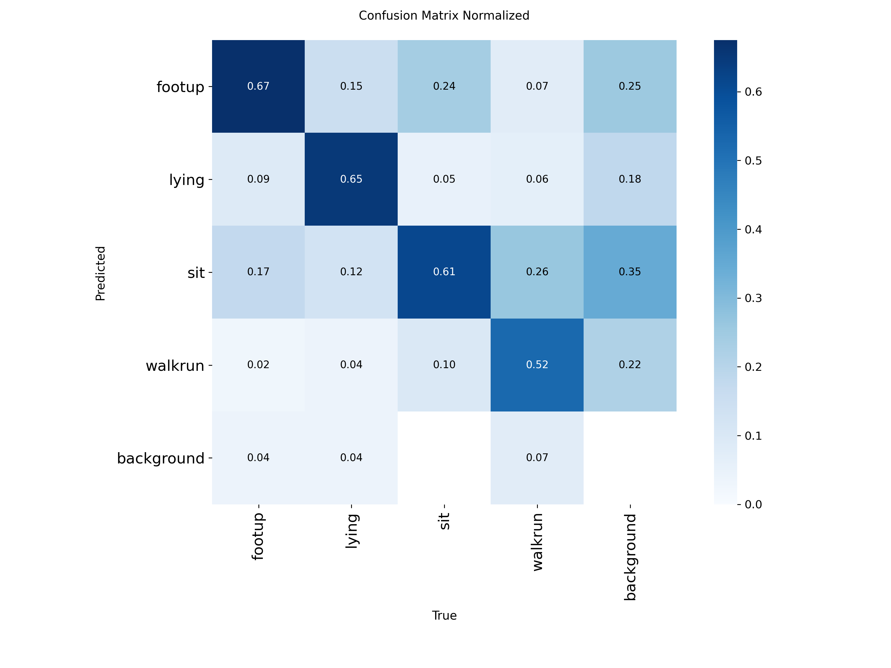
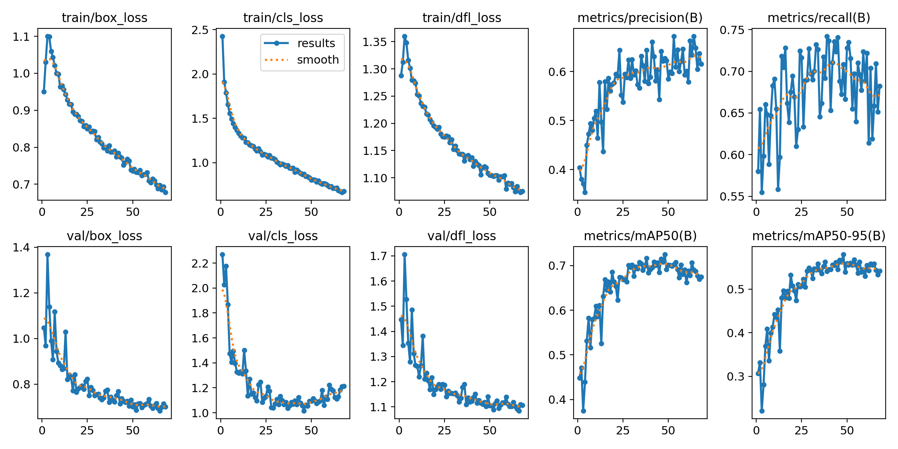
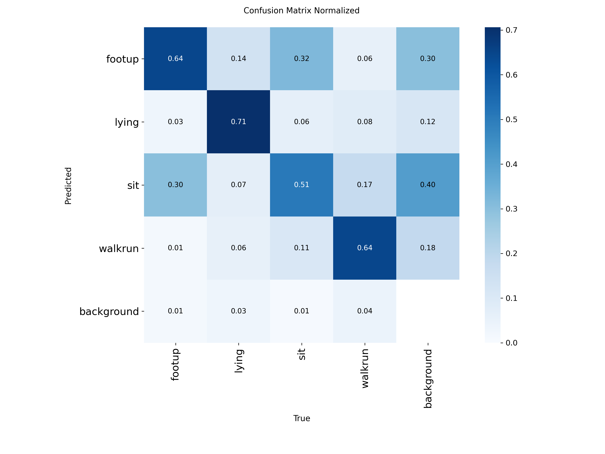
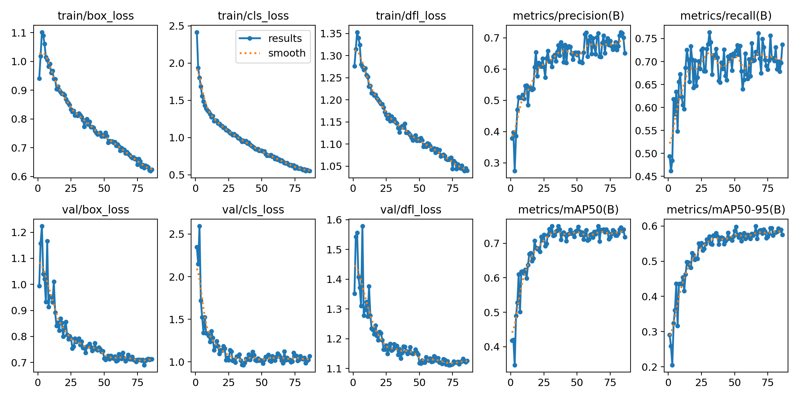
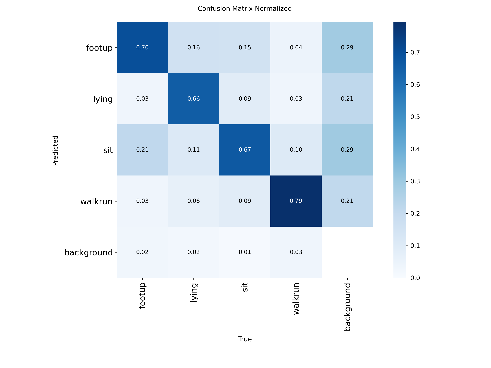

# dog-behavior-analysis

반려견의 행동(손 주기/누움/앉음/걷거나 뜀)을 이미지에서 탐지하는 YOLOv8 기반 프로젝트입니다.

## 클래스

| 클래스 | 설명 |
|---|---|
| `footup` | 손(앞발) 주기 |
| `lying` | 누움 |
| `sit` | 앉음 |
| `walkrun` | 걷거나 뜀 |

## 데이터

[AI Hub 반려동물 행동 영상 데이터](https://www.aihub.or.kr/)를 사용합니다. 원본 영상에서 프레임을 추출한 이미지와, 프레임별 bounding box·keypoint 라벨(JSON)이 클래스 폴더별로 제공됩니다.

원본 데이터가 크기 때문에(클래스당 영상 수천 개, 프레임 수만 장) 파이프라인 검증용으로 아래 기준으로 소규모 서브셋을 뽑아 사용합니다.

- **클래스당 400장** (train 320 / val 80, 80:20 분할)
- **영상 단위로 먼저 train/val 분할** 후, 각 영상에서 프레임 1장만 무작위 추출 — 같은 영상의 프레임이 train/val 양쪽에 섞여 생기는 데이터 유출(leakage) 방지
- 시드 고정(42)으로 재현 가능

## 프로젝트 구조

```
dog-pose-project/
  RAW/                    # 원본 데이터
    images/<class>/<video_id>.mp4/frame_*.jpg
    labels/<class>/<video_id>.mp4.json
  dataset/                # 학습용 서브셋
    manifest.csv           # 추출된 이미지 ↔ 원본 영상 매핑 + 견종/행동 설명
    data.yaml               # YOLO 학습용 데이터셋 설정
  scripts/
    build_dataset.py         # RAW에서 소규모 데이터셋 추출 (이미지 복사 + manifest 생성)
    convert_to_yolo.py       # JSON bounding_box → YOLO txt 라벨 변환
  assets/                  # README용 결과 이미지
  requirements.txt
```

## 환경 설정

```bash
pip install -r requirements.txt
```

- PyTorch는 CUDA 12.8(cu128) 빌드로 고정되어 있습니다 — RTX 50 시리즈(Blackwell, sm_120) GPU 지원

## 데이터 준비

```bash
python scripts/build_dataset.py     # RAW → dataset/images, dataset/manifest.csv
python scripts/convert_to_yolo.py   # manifest.csv 기준으로 dataset/labels/*.txt 생성
```

## 학습

wandb로 실험을 기록합니다.

```bash
wandb login                 # 최초 1회
yolo settings wandb=True    # 최초 1회

yolo detect train model=yolov8n.pt data=dataset/data.yaml \
  epochs=100 imgsz=640 batch=16 patience=20 \
  project=dog-pose-behavior name=yolov8n-baseline
```

## Baseline 결과 (yolov8n, 클래스당 400장)

99 epoch에서 조기 종료 (best epoch 79, `patience=20`).

| metric | 값 (best epoch 기준) |
|---|---|
| precision | 0.669 |
| recall | 0.628 |
| mAP50 | 0.679 |
| mAP50-95 | 0.542 |



### Confusion Matrix



클래스별 정확도: `footup` 0.67, `lying` 0.65, `sit` 0.61, `walkrun` 0.52. 눈에 띄는 혼동은 `walkrun`→`sit` 26%, `footup`→`sit` 24% — `sit`이 다른 클래스의 애매한 프레임을 흡수하는 경향이 있습니다 (걷다가 멈칫하는 순간, 손 주며 앉아있는 프레임 등이 단순 `sit`으로 오분류).

## 실험 1: 데이터 2배 증량 (yolov8n, 클래스당 800장)

`build_dataset.py`의 `IMAGES_PER_CLASS`를 400에서 800으로 바꿔 데이터만 늘렸습니다.

68 epoch에서 조기 종료 (best epoch 48, `patience=20`).

| metric | 값 (best epoch 기준) |
|---|---|
| precision | 0.627 |
| recall | 0.708 |
| mAP50 | 0.725 |
| mAP50-95 | 0.580 |



### Confusion Matrix



클래스별 정확도: `lying` 0.71, `walkrun` 0.64, `footup` 0.64, `sit` 0.51. baseline(400장) 대비 recall·mAP50·mAP50-95는 올랐지만 precision은 소폭 하락했고, `walkrun`→`sit` 혼동은 26%→11%로 줄어든 반면 `footup`↔`sit` 혼동은 오히려 늘었습니다(24%→32%, 17%→30%). 영상당 프레임을 완전 무작위로 뽑다 보니 라벨은 `footup`/`walkrun`이어도 실제로는 앉아있는 순간의 프레임이 섞여 들어가는 라벨 노이즈가 원인으로 보이며, 데이터를 늘릴수록 노이즈도 비례해서 늘어나 `footup`-`sit` 경계는 개선되지 않은 것으로 보입니다.

## 실험 2: 프레임 선택 방식 개선 (yolov8n, 클래스당 800장)

실험 1에서 확인된 라벨 노이즈를 줄이기 위해 프레임 선택 방식을 바꿨습니다. `footup` 외 클래스는 영상 중간 구간(프레임 순서 기준 40-60%)에서, `footup`은 JSON keypoints로 앞다리/발(10-15번, 변동폭 분석으로 추정)이 가장 높이 올라간 프레임을 고르도록 했습니다.

86 epoch에서 조기 종료 (best epoch 66, `patience=20`).

| metric | 값 (best epoch 기준) |
|---|---|
| precision | 0.715 |
| recall | 0.721 |
| mAP50 | 0.750 |
| mAP50-95 | 0.600 |



### Confusion Matrix



클래스별 정확도: `footup` 0.70, `lying` 0.66, `sit` 0.67, `walkrun` 0.79. 실험 1 대비 precision·recall·mAP50·mAP50-95 전부 올랐고, `footup`↔`sit` 혼동이 뚜렷이 줄었습니다(footup→sit 32%→21%, sit→footup 30%→15%). 다만 `lying`→`footup` 오분류는 14-16% 수준으로 실험 1 때부터 남아있습니다.